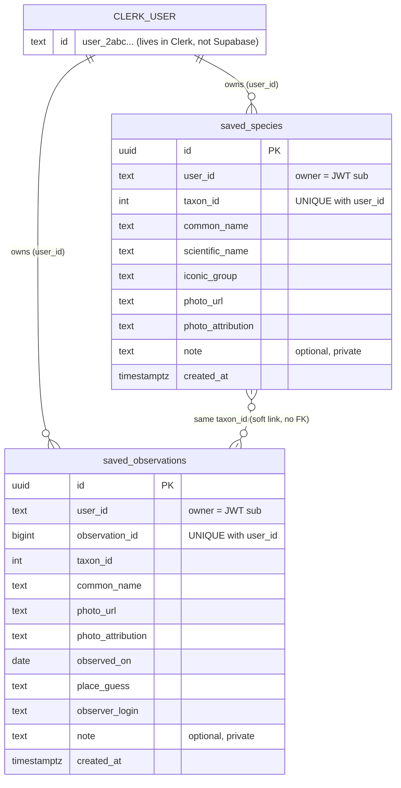

# FERA — Project Context

Assignment 4: Full Stack App · Design, Build, Ship · MPCS 51238 · Autumn 2026

**Read this file before building anything.** It records decisions already made with the project owner. Do not change the data model or make product decisions without discussing them first.

## Project

FERA is a web application where users can discover and explore real wildlife from around the world, search for animals, browse wildlife observations, and save their favorite discoveries to revisit later. Each person signs in and sees only their own saved items.

## Tech Stack

- Next.js + Tailwind CSS
- Clerk for sign-in (stay on development keys)
- Supabase for the database, with row-level security on every table
- iNaturalist API (`https://api.inaturalist.org/v1`) as the one external API, with no key required
- Deployed on Vercel (free Hobby plan); code in the owner's GitHub repository

## Progress

| Step | Status |
|---|---|
| 1. Choose tool and API | ✅ Done. See `STEP_1_API_EXPLORATION.md` |
| 2. Plan the data | ✅ Done. Data model below |
| 3. Protect your keys | ✅ Done. `.claude/settings.json` deny rule + `.gitignore` for `.env*` |
| 4. Add sign-in with Clerk | ✅ Done. See "Authentication (Step 4)" below |
| 5. Add Supabase and connect it to Clerk | ✅ Done. See "Database & Supabase (Step 5)" below |
| 6–8 | Not started |

No iNaturalist features exist yet. Saving items from the UI is not built yet (needs the API features).

## Decisions Made (Step 2)

| # | Decision |
|---|---|
| 1 | Save **both** species and individual observations (sightings) |
| 2 | Users can add an optional **private note** to any saved item |
| 3 | **No custom collections** for now (may be considered later) |
| 4 | **Two separate tables**: `saved_species` and `saved_observations` |
| 5 | **Snapshot caching**: store the iNaturalist ID plus only the essential display info (names, image URL, photo attribution) |

There is no `users` table. Clerk owns user accounts. Our tables only reference the Clerk user ID.

---

## Data Model

### `saved_species`

Animals (taxa) a user has saved.

| Column | Type | Constraints / Default | Source / Purpose |
|---|---|---|---|
| `id` | `uuid` | primary key, default `gen_random_uuid()` | Row ID |
| `user_id` | `text` | not null, default `auth.jwt()->>'sub'` | **Owner**: Clerk user ID |
| `taxon_id` | `integer` | not null | iNaturalist taxon `id` (e.g. `42069`) |
| `common_name` | `text` | nullable | `preferred_common_name` (e.g. "Red Fox"); some taxa have none |
| `scientific_name` | `text` | not null | `name` (e.g. "Vulpes vulpes") |
| `iconic_group` | `text` | nullable | `iconic_taxon_name` (e.g. "Mammalia"), used to group "My Discoveries" |
| `photo_url` | `text` | nullable | `default_photo.medium_url` |
| `photo_attribution` | `text` | nullable | `default_photo.attribution`, which must be shown with the photo |
| `note` | `text` | nullable, `char_length(note) <= 2000` | User's private note |
| `created_at` | `timestamptz` | not null, default `now()` | When it was saved |

Table constraint: `UNIQUE (user_id, taxon_id)`, so a user can save each species only once.

### `saved_observations`

Specific sightings a user has saved.

| Column | Type | Constraints / Default | Source / Purpose |
|---|---|---|---|
| `id` | `uuid` | primary key, default `gen_random_uuid()` | Row ID |
| `user_id` | `text` | not null, default `auth.jwt()->>'sub'` | **Owner**: Clerk user ID |
| `observation_id` | `bigint` | not null | iNaturalist observation `id` (e.g. `411190259`) |
| `taxon_id` | `integer` | nullable | `taxon.id`, a soft link to `saved_species` (no FK); null if the sighting is unidentified |
| `common_name` | `text` | nullable | `taxon.preferred_common_name`, falling back to `species_guess` |
| `photo_url` | `text` | nullable | `photos[0].url`, resized to `medium` |
| `photo_attribution` | `text` | nullable | `photos[0].attribution` |
| `observed_on` | `date` | nullable | When the animal was seen |
| `place_guess` | `text` | nullable | Readable location (e.g. "Wellington Township, OH 44090, USA") |
| `observer_login` | `text` | nullable | `user.login`, the person who made the sighting |
| `note` | `text` | nullable, `char_length(note) <= 2000` | User's private note |
| `created_at` | `timestamptz` | not null, default `now()` | When it was saved |

Table constraint: `UNIQUE (user_id, observation_id)`, so a user can save each sighting only once.

The link back to iNaturalist is not stored. It is built from the ID: `https://www.inaturalist.org/observations/{observation_id}`.

### Diagram



Plain-text version:

```
                    ┌────────────────────────────┐
                    │      Clerk (external)      │
                    │  user.id = "user_2abc…"    │
                    └─────────────┬──────────────┘
                                  │ JWT "sub" claim = user_id
              ┌───────────────────┴────────────────────┐
              │ 1 user ── many rows                    │ 1 user ── many rows
              ▼                                        ▼
┌──────────────────────────────┐        ┌──────────────────────────────────┐
│ saved_species                │        │ saved_observations               │
├──────────────────────────────┤        ├──────────────────────────────────┤
│ id              uuid PK      │        │ id               uuid PK         │
│ user_id         text ◄ owner │        │ user_id          text ◄ owner    │
│ taxon_id        int          │◄ ─ ─ ─ │ taxon_id         int             │
│ common_name     text         │  soft  │ observation_id   bigint          │
│ scientific_name text         │  link  │ common_name      text            │
│ iconic_group    text         │ (no FK)│ photo_url        text            │
│ photo_url       text         │        │ photo_attribution text           │
│ photo_attribution text       │        │ observed_on      date            │
│ note            text (opt.)  │        │ place_guess      text            │
│ created_at      timestamptz  │        │ observer_login   text            │
│ UNIQUE(user_id, taxon_id)    │        │ note             text (opt.)     │
└──────────────┬───────────────┘        │ created_at       timestamptz     │
               │                        │ UNIQUE(user_id, observation_id)  │
               │ taxon_id               └────────────────┬─────────────────┘
               ▼                                         ▼ observation_id
     ┌──────────────────────────────────────────────────────────────┐
     │           iNaturalist API (external, read-only)              │
     │       /v1/taxa/{taxon_id}       /v1/observations/{id}        │
     └──────────────────────────────────────────────────────────────┘
```

### Relationships

- **User → rows:** one Clerk user owns many rows in each table. Every row belongs to exactly one user, identified by `user_id`.
- **Between tables:** `saved_observations.taxon_id` can match `saved_species.taxon_id`, which allows features like "3 of your sightings are Red Foxes." There is no foreign key, because a user can save a sighting without saving its species (and vice versa).
- **To iNaturalist:** `taxon_id` and `observation_id` are iNaturalist IDs. The cached columns are a small snapshot for display. Detail pages fetch fresh data from the API.

### Who owns what

| Data | Owner | Stored in |
|---|---|---|
| Account, email, sign-in | Clerk | Clerk |
| Saved species, saved sightings, notes | The individual user | Supabase, tagged with `user_id` |
| Species info, photos, sightings | iNaturalist (public) | Not stored, except the cached snapshot |

---

## How `user_id` Identifies the Owner

1. A user signs in with Clerk. Clerk issues a signed session token (JWT) whose `sub` claim is the Clerk user ID, e.g. `user_2abc…`.
2. The app sends this token with every Supabase request.
3. Supabase's **third-party auth integration with Clerk** verifies the token's signature, so `auth.jwt()` inside the database can be trusted.
4. On insert, `user_id` defaults to `auth.jwt()->>'sub'`, so the database fills in the owner. The client should not send `user_id`. If it does, the RLS insert check rejects any value that isn't the signed-in user's own ID.
5. `user_id` is `text`, not `uuid`, because Clerk IDs are not UUIDs.

## Row-Level Security (RLS) and Privileges

Implemented in `supabase/migrations/20261027200419_create_saved_tables.sql` (Step 5).

RLS is **enabled on both tables**. With RLS on and no matching policy, access is denied.

### Privileges (table grants)

The project does not auto-expose new tables, so the migration grants explicitly:

| Role | Privileges |
|---|---|
| `anon` (signed out) | **None** (all revoked, including the default `TRUNCATE`) |
| `authenticated` | `SELECT`, `INSERT`, `DELETE`; `UPDATE` on the **`note` column only** |

`TRUNCATE` is never granted because it ignores RLS. Updating any column other than `note` (including `user_id`) fails with "permission denied".

### Policies

The same four policies apply to `saved_species` and `saved_observations`, all for the `authenticated` role:

| Operation | Policy name (saved_species / saved_observations) | Check |
|---|---|---|
| **SELECT** | Users can view their own saved species / observations | `USING ((select auth.jwt()->>'sub') = user_id)` |
| **INSERT** | Users can save species / observations as themselves | `WITH CHECK ((select auth.jwt()->>'sub') = user_id)` |
| **UPDATE** | Users can update their own saved species / observations | `USING (…)` and `WITH CHECK (…)`, same expression |
| **DELETE** | Users can delete their own saved species / observations | `USING ((select auth.jwt()->>'sub') = user_id)` |

Notes:
- `USING` filters which existing rows a query can see or touch. `WITH CHECK` validates the new or changed row.
- `(select auth.jwt()->>'sub')` is evaluated once per query (an InitPlan), not per row.
- No policies exist for `anon`.
- To change the schema or policies, add a **new** migration file; never edit an applied one.

## How the Model Supports the App

- **"My Discoveries":** `select * from saved_species` and `select * from saved_observations`. RLS returns only the signed-in user's rows, with no manual filtering needed for security.
- **Save / unsave:** an insert or a delete. The unique constraints make a repeated save harmless.
- **Notes:** an update of the `note` column on the user's own row.
- **Persistence:** rows live in Supabase, so saved items survive signing out and back in, and work on any device.
- **Snapshot caching:** "My Discoveries" loads with one database query per table instead of one API call per item. It respects iNaturalist's ~60 requests/minute guidance and still shows saved items when the API is down. The trade-off is that cached names or photos may go out of date. Detail pages always load fresh data.

## Authentication (Step 4)

- **Clerk application:** "Wildlife Explorer" (`app_3LHz65bQ9M6e37YnYugjTKjgxNd`), development instance. Sign-in options: username, email, Google. Do not create another Clerk app.
- **Setup:** the owner ran `npx -y clerk@latest init --app app_3LHz65bQ9M6e37YnYugjTKjgxNd` themselves, which installed `@clerk/nextjs` v7, created `proxy.ts` and the sign-in/sign-up pages, wrapped the layout in `<ClerkProvider>`, wrote the Clerk keys to `.env.local`, and installed Clerk agent skills in `.agents/skills/`.
- **Environment variables:** the owner manages `.env.local` manually. The agent must never read, display, create, or modify it, including via shell commands or CLI commands that write env files (e.g. `clerk env pull`). Ask the owner to run those.
- **Verify the integration** with `npx -y clerk@latest doctor` (redact any key-like output).

### Routes

| Route | Access | File |
|---|---|---|
| `/` | Public | `app/page.tsx` (placeholder home) |
| `/sign-in` | Public | `app/sign-in/[[...sign-in]]/page.tsx` |
| `/sign-up` | Public | `app/sign-up/[[...sign-up]]/page.tsx` |
| `/discoveries` | **Signed-in only** | `app/discoveries/page.tsx` (placeholder for "My Discoveries") |

### How routes are protected

- `proxy.ts` runs a bare `clerkMiddleware()` so the session is available everywhere. It does **not** decide which routes need auth.
- Each protected page, Route Handler, and Server Action calls `await auth.protect()` at the top. Signed-out visitors to a page are redirected to `/sign-in?redirect_url=…`. Do not use `createRouteMatcher` (deprecated in `@clerk/nextjs` v7).
- `next.config.ts` has `cacheComponents: true` (Next.js 16 default), so anything that reads auth (`auth()`, `<Show>`, `<SignIn />`, `<SignUp />`) must sit inside `<Suspense>`, and a page gated by `auth.protect()` needs a `loading.tsx` next to it.
- Because of streaming, a signed-out request to a protected page returns HTTP 200 with a client-side redirect to sign-in (not a 307). The body contains no protected content.
- The header (`app/layout.tsx`) uses `<Show when="signed-out">` / `<Show when="signed-in">`: Sign in / Sign up when signed out; My Discoveries, Sign out, and `<UserButton />` when signed in.
- Clerk only controls who reaches pages. Database-level protection (RLS) arrives in Step 5.

## Database & Supabase (Step 5)

- **Supabase project:** `imecgakouqidfgjndkep` (`https://imecgakouqidfgjndkep.supabase.co`). The agent uses the Supabase MCP server scoped to this project (`.mcp.json`, no secrets in it).
- **Clerk ↔ Supabase:** Supabase **Third-Party Auth** with Clerk (Clerk domain `working-horse-868.clerk.accounts.dev`). Clerk session tokens carry `role: "authenticated"` and `sub` = Clerk user ID. Supabase verifies them against Clerk's public keys. Do **not** use the deprecated Clerk JWT templates / shared JWT secret.
- **Env variables** (owner-managed in `.env.local`): `NEXT_PUBLIC_SUPABASE_URL`, `NEXT_PUBLIC_SUPABASE_PUBLISHABLE_KEY`. The app never uses the Supabase secret key (it bypasses RLS).
- **Migrations:** `supabase/migrations/`. Applied through the Supabase MCP `apply_migration`; the file name matches the applied version.

### Supabase clients

| File | Use in | How it authenticates |
|---|---|---|
| `lib/supabase/server.ts` → `createServerSupabaseClient()` | Server Components, Route Handlers, Server Actions | `accessToken` returns `(await auth()).getToken()` (Clerk server) |
| `lib/supabase/client.ts` → `useSupabaseClient()` | Client Components | `accessToken` returns `session?.getToken()` (Clerk `useSession`) |

- Do not filter by `user_id` for security; RLS already limits results to the signed-in user. Do not send `user_id` on insert; it defaults from the token.
- `/discoveries` currently shows the counts of the user's saved species and sightings (read through the server client) and a generic error message if the query fails.

### Verified in Step 5

- **Simulated SQL tests** (as `authenticated` with fake `sub` claims and as `anon`, rolled back): own rows only; another user's rows can't be read, updated, or deleted (0 rows affected); inserting with another user's `user_id` → RLS violation; omitted `user_id` defaults to the caller; duplicate save → unique violation; updating non-`note` columns and `TRUNCATE` → permission denied; `anon` select/insert → permission denied.
- **Real-token API tests** (a genuine Clerk session token via Supabase REST): select/insert/update-note/delete own rows succeed; spoofed `user_id` → 403; updating `common_name` → 403; no token → 401. Test row removed afterwards.
- **App:** `/discoveries` signed in loads counts from Supabase without errors; signed out, it redirects to sign-in.
- **Advisors:** performance lint `auth_rls_initplan` flags all 8 policies, but EXPLAIN shows an InitPlan, so it's a pattern-matching false positive. Security lint flags `public.rls_auto_enable()` (Supabase's auto-RLS event-trigger function, not part of FERA's migration).

## API Notes (from Step 1)

- "Not found" returns **HTTP 200** with `total_results: 0` and `results: []`, so check `total_results`, not the status.
- Search matches the start of names and **does not correct typos**.
- **Invalid parameters are silently ignored**, so validate inputs before calling.
- Many photos are "all rights reserved", so **always display photo attribution**.
- Some sighting locations are deliberately obscured (`obscured`, `geoprivacy`), so don't present them as exact.
- Required UI states: **loading**, **nothing found**, **API unavailable**.

## Working Rules for the Agent

- Work one assignment step at a time and wait for approval before moving on.
- Do not make product or design decisions without discussing them. No visual style, palette, or layout has been chosen.
- Do not change this data model without discussion. If a change is agreed, update this file first.
- Keys go in `.env.local` only, never in code or commits.
- Do not modify other projects outside the FERA folder.

<!-- BEGIN:nextjs-agent-rules -->

## This is NOT the Next.js you know

This version has breaking changes — APIs, conventions, and file structure may all differ from your training data. Read the relevant guide in `node_modules/next/dist/docs/` (resolved from this file's directory; in monorepos the `next` package may not be visible from the repo root) before writing any code. Heed deprecation notices.

This block is written and re-added by `next dev` — verify at `node_modules/next/dist/server/lib/generate-agent-files.js`. Removing it from a diff only re-creates the uncommitted change; committing it with your work keeps the tree clean.

<!-- END:nextjs-agent-rules -->
