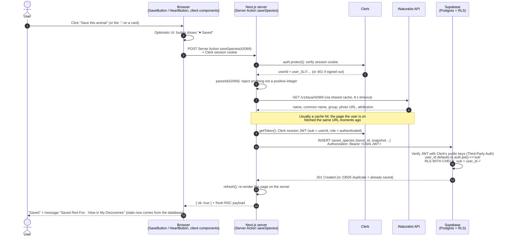

# One request, from the click to the screen

Example: a signed-in user on the Red Fox page (`/species/42069`) clicks **Save this animal**. (The ♡ on a card in search results, a group, or Recent sightings makes the same request.)

## The same flow in words (for class)

1. **Browser.** The user clicks *Save this animal* (or a card's ♡). The control flips to "Saved" immediately (optimistic UI) and calls a **Server Action**, which is a POST to FERA's own server. The browser only sends the iNaturalist ID, never names or photos, and never a `user_id`.
2. **Next.js server → Clerk.** `auth.protect()` checks the Clerk session cookie. Signed out → the action stops with 401 and nothing is written.
3. **Validation.** The ID must be a positive integer, because iNaturalist silently ignores bad parameters.
4. **Next.js server → iNaturalist.** The server fetches the species to build the snapshot (name, photo URL, photo credit). All iNaturalist calls happen on the server and go through a shared ~1-minute cache, so this is usually a cache hit and FERA stays far below iNaturalist's ~60 requests/minute guidance. No API key is involved.
5. **Next.js server → Supabase.** The Supabase client attaches the user's **Clerk session token**. Supabase verifies it against Clerk's public keys (Third-Party Auth), so `auth.jwt()->>'sub'` is the Clerk user ID.
6. **Database.** `user_id` is filled in from the token. The RLS insert policy checks it matches. The unique constraint makes a double-click harmless.
7. **Back to the screen.** `refresh()` re-renders the page on the server; the button, the card hearts and the header's saved count now reflect what's actually in the database (they read the user's saved IDs through the same Clerk-authenticated Supabase client, with RLS limiting the rows to that user). A confirmation message with a link to My Discoveries appears. If anything failed, the optimistic state rolls back and a message explains why.

*Removing* follows the same path (`removeSaved` → `DELETE`), but the browser first asks inline "Remove? Yes / No", because deleting also deletes the private note.

## Why the API is called on the server

| Reason | Detail |
|---|---|
| Rate limits & caching | One shared cache serves every visitor, instead of every browser calling iNaturalist separately |
| Trustworthy snapshots | The saved name/photo/credit comes from iNaturalist via the server, not from the browser |
| One place for error handling | `lib/inaturalist.ts` turns timeouts and errors into the designed **loading / nothing found / unavailable** states |
| Input validation | Queries and IDs are checked once, on the server |
| Keys | iNaturalist needs none; Clerk and Supabase keys stay in environment variables, and the Supabase secret key is never used |
